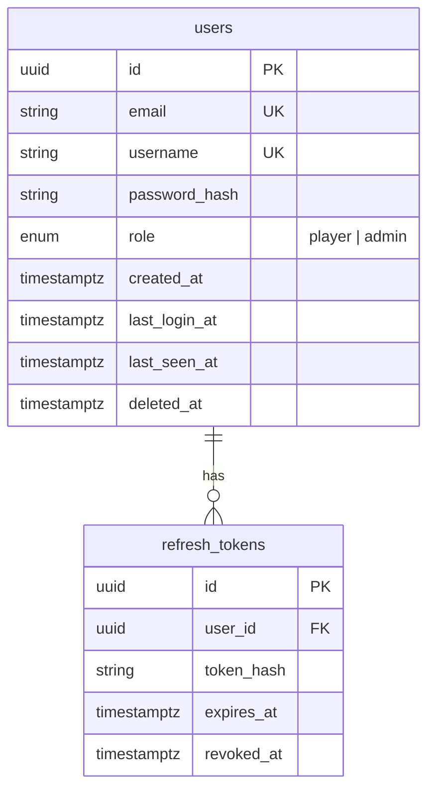
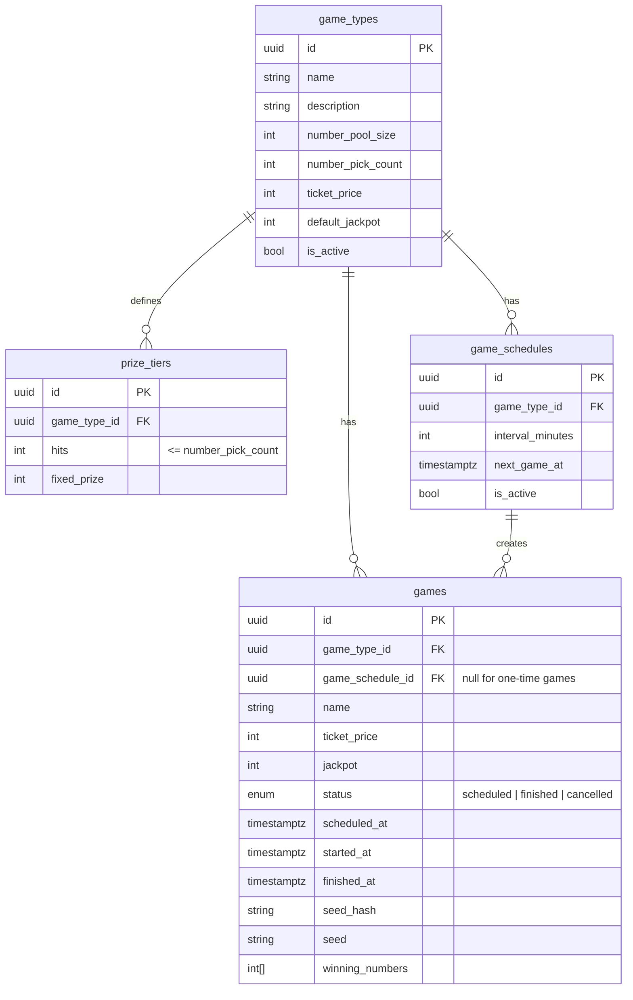
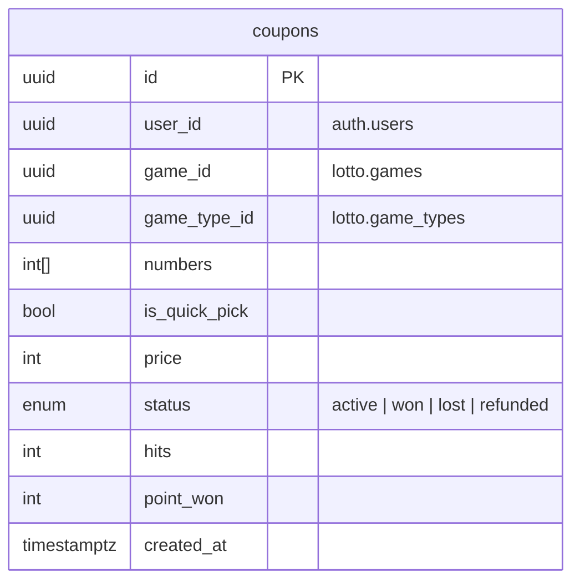
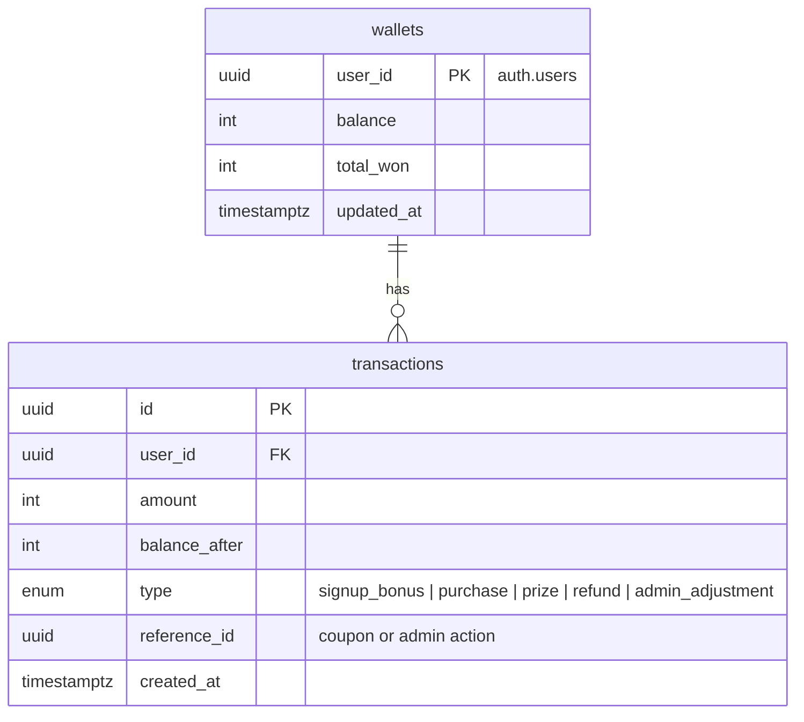
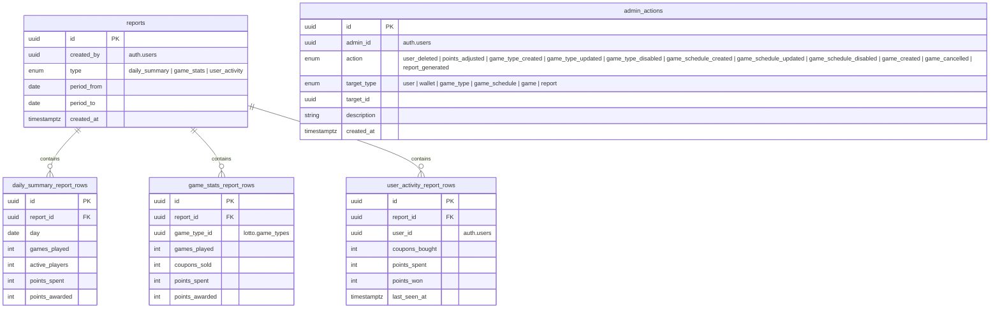
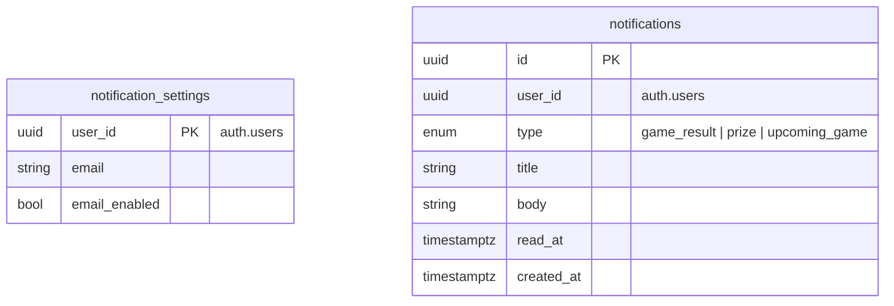

# 007: Database schema

## Status

Proposed, 31.10.2026

## Context

[ADR 005](005-Database.md) decided that each microservice owns its data in a separate PostgreSQL
database. This document defines the schema of each of those databases.

## Decision

### General rules

- Primary keys are UUIDs. Points are integers. Timestamps are stored in UTC.
- There are no foreign keys across databases. A column such as `user_id` holds the ID from the owning
  service (e.g. `auth.users`), and services keep it in sync through events from [ADR 006](006-Message-broker.md).

### auth

Accounts, roles and sessions.

### lotto

Game types, prize tiers, schedules and games.

- A **game type** is defined by the administrator: its rules, price and prizes.
- A **game** is one draw of a game type, at a given time. It copies the ticket price and jackpot from
  its game type, and the administrator can change them for a single game.
- **Prize tiers** list the hit counts that win. The tier with the highest `hits` is the main prize:
  its winners split the game's jackpot. Every other tier pays a certain `fixed_prize`.
- A **game schedule** creates games repeatedly, every `interval_minutes`. One-time games are
  created directly and have no schedule.
- `seed_hash` is published before the game and `seed` after it, so players can verify the result.

### betting

Coupons. `game_type_id` is stored for filtering the coupon history by game type. `hits` (matched
numbers) and `points_won` are set when the game is finished.

### wallet

Balances and the history of operations. Every change of balance is a transaction. `total_won` is kept
for the winnings leaderboard.

### admin

A log of global administrator actions, and generated reports.

- `target_type` says which kind of object `target_id` points to, since it lives in another service.
- When a report is generated, statistics are read from the other services and saved as rows in the
  table for that report type:
  - `daily_summary`: one row per day, for the charts in the statistics view
  - `game_stats`: one row per game type, for game popularity
  - `user_activity`: one row per player

### notifications

In-app notifications and per-user settings.

## Consequences

All members of the team will stick to the schema presented in this document. Changes to the schema
are made through Alembic migrations, and larger changes are recorded in a new ADR.
